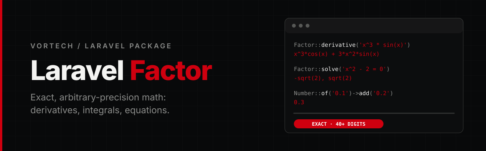

<p align="center">
  
</p>

<p align="center">
  <a href="https://github.com/Vortech-Group/factor/actions/workflows/tests.yml"></a>
  <a href="https://packagist.org/packages/vortech/laravel-factor"></a>
  <a href="https://packagist.org/packages/vortech/laravel-factor"></a>
  <a href="https://packagist.org/packages/vortech/laravel-factor"></a>
  
  <a href="LICENSE.md"></a>
</p>

<p align="center">
  <strong>Exact, arbitrary-precision math</strong> for Laravel: symbolic <strong>differentiation</strong>, numeric <strong>integration</strong> and <strong>equation solving</strong>.<br>
  Rational arithmetic with no floats, results you can round once at the end, and numeric methods that report how far to trust them.
</p>

---

## Why

Pricing, reserves, premiums and annuities are sums of small numbers raised to large powers. In floats the error is invisible until it is a cent. Factor does the arithmetic exactly and tells you how good everything else is.

| | PHP floats | Factor |
|---|---|---|
| `0.1 + 0.2` | `0.30000000000000004` | exactly `0.3` |
| `1.05^10 * 100000` | `162889.4626777442` | exactly `162889.462677744140625` |
| `sin`, `ln`, `exp` | about 15 significant digits | as many places as you configure (default 40) |
| An integral that did not converge | a number, silently | a number, an error estimate and `converged = false` |
| Rounding | whenever an operation happens | once, where you say so, with the mode you choose |

## Requirements

- PHP 8.3+ with `ext-bcmath`
- Laravel 12 or 13

## Installation

```bash
composer require vortech/laravel-factor
```

The service provider and the `Factor` facade are discovered automatically. To change the defaults, publish the config:

```bash
php artisan vendor:publish --tag=factor-config
```

## Usage

The `Factor` facade is the entry point. Operations chain, because a derivative is an `Expression` again.

```php
use Vortech\Factor\Facades\Factor;

Factor::derivative('x^3 * sin(x)');                  // x^3*cos(x) + 3*x^2*sin(x)
Factor::integrate('exp(-x^2)', 0, 1)->toDecimal(30); // 0.746824132812427025399467436132
Factor::solve('x^2 - x - 1 = 0')->roots();           // (1 ± sqrt(5)) / 2, exact
Factor::root('cos(x) = x', near: 1)->toDecimal(30);  // 0.739085133215160641655312087674
Factor::system(['x + y = 3', 'x - y = 1']);          // ['x' => 2, 'y' => 1]
```

```php
Factor::derivative('x^3 * sin(x)')->integrate(0, 1);    // IntegralResult, here sin(1)
Factor::derivative('x^3 - 3x')->solve();                // the critical points
Factor::derivative('sin(x)')->root(between: [1, 2]);    // pi/2
```

`integrate()` needs bounds: integrals are numeric, so there is no antiderivative to return.

Outside Laravel use the classes directly: `new Vortech\Factor\Factor(new Context(precision: 40))`.

### Numbers and precision

- **Arithmetic is exact.** `Number` is a rational number (an integer over an integer, in lowest terms). `+ - * /` and integer powers never round: `0.1 + 0.2` is exactly `0.3`, `1/3 * 3` is exactly `1`, `(1 + 0.05)^10 * 100000` is exactly `162889.462677744140625`. Inputs are read as decimals, not floats, so `0.1` is exactly one tenth.
- **Functions are computed to `precision` decimal places** (default 40) with extra guard digits, so the places you asked for are trustworthy. The functions are checked against published constants to 50 places and against each other across precisions.
- **Rounding is yours to do, once, at the end.** `toDecimal(2)` rounds half away from zero; pass a `RoundingMode` for banker's rounding, floor, ceiling and so on. Nothing is rounded behind your back.
- **Numeric methods report their quality.** Integration returns an error estimate and `converged`; root finding returns the residual and `converged`. A hard integrand is reported, not silently approximated.

```php
use Vortech\Factor\Numbers\Number;
use Vortech\Factor\Numbers\RoundingMode;

Number::of('0.1')->add('0.2');                       // 0.3, exactly
Number::of('1/3')->mul(3);                           // 1
Number::of('2.5')->toDecimal(0, RoundingMode::HalfEven); // "2"
Number::of('162889.462677744140625')->toDecimal(2);  // "162889.46"
```

`precision` counts decimal places after the point, not significant digits: `exp(-100)` at 40 places is `0`. `Number::of(0.1)` takes a float as its shortest decimal (`0.1`), but prefer strings for money.

A value you evaluate keeps a few guard digits beyond `precision`; round it with `toDecimal()` when you show or store it.

### Expressions

```php
use Vortech\Factor\Expressions\Expression;

$expression = Expression::parse('3x^2 - sin(2x)/5');
$expression->toString();                // 3*x^2 - 0.2*sin(2*x)
$expression->toLatex();                 // 3 x^{2} - 0.2 \sin\left(2 x\right)
$expression->evaluate(['x' => '1/3']);  // a Number
$expression->with(['x' => '1/3']);      // an Expression, substituted exactly

// the same, built fluently
$x = Expression::variable('x');
$x->pow(2)->times(3)->minus($x->times(2)->sin()->dividedBy(5));
```

Syntax: `+ - * / ^` (or `**`), parentheses, decimals (`0.1`, `1e-3`), the constants `pi` and `e`, implicit multiplication (`2x`, `2(x+1)`, `x y`; a name is a whole word, so `xy` is one variable), and the functions `sin cos tan asin acos atan sinh cosh tanh exp ln sqrt cbrt log10 log2` and `log(x, base)`. Functions need parentheses.

Every expression is kept in a canonical form: `x + x` is `2*x`, `x*x` is `x^2`, `x - (x+1)` is `-1`, `e^x` is `exp(x)`. Equal expressions compare equal (`equals()`), and printing then parsing gives the same expression back. Products are not expanded: `(x+1)*(x-1)` stays factored.

Expressions may come from users: the parser builds a tree and never runs code, and it limits the text length (`max_length`) and the nesting (`max_depth`).

### Differentiation

Symbolic and exact, to any order:

```php
Factor::derivative('x^x');                  // x^x*(ln(x) + 1)
Factor::derivative('x^4', 'x', order: 2);   // 12*x^2
Factor::derivativeAt('x^3 - 4x', '1/3');    // -11/3, exactly

$expression = Expression::parse('x^2*y + sin(y)');
$expression->derivative('x');  // 2*x*y
$expression->gradient();       // ['x' => 2*x*y, 'y' => x^2 + cos(y)]
```

### Integration

Definite integrals, numerically. The bounds may be numbers or text such as `'pi/2'`.

```php
$result = Factor::integrate('4/(1+x^2)', 0, 1);

$result->toDecimal(30);   // "3.141592653589793238462643383280"
$result->error;           // estimated absolute error, a Number
$result->converged;       // true when the error estimate is within the precision
$result->evaluations;     // how many times the function was evaluated
```

The default method is an adaptive Gauss-Legendre rule: 20 nodes per panel, halving where the estimate disagrees, never evaluating the end points. `IntegrationMethod::Romberg` is available but needs many more evaluations at high precision.

Smooth integrands converge in tens to hundreds of evaluations. An integrable singularity at an end point (`sqrt(x)` on `[0, 1]`) converges at modest precision; one that is too strong (`ln(x)` on `(0, 1]` at 40 places) hits the refinement limit and reports `converged = false` with its error estimate, and a substitution that removes the singularity is the fix. Infinite bounds are not supported.

### Solving equations

`solve()` handles polynomial equations in one variable:

```php
$solution = Factor::solve('x^2 - 5x + 6 = 0');
$solution->values();                  // Collection of Numbers: 2, 3
$solution->nth(1)->exact;   // true, counting from 1

Factor::solve('x^2 - x - 1')->nth(2)->expression;   // 0.5*sqrt(5) + 0.5
Factor::solve('x^2 + 2x + 5')->nth(1)->toDecimal(2); // "-1.00 - 2.00i"
```

- Degree 1 and 2 are solved in closed form: rational roots stay rational, the others carry an exact expression (`$root->expression`) next to their value, and complex roots come as conjugate pairs.
- Higher degrees are solved numerically to `precision` places; every real root that is rational is recognised, **verified exactly**, and divided out, so `x^3 - 2x^2 - 2x + 4` still gives `±sqrt(2)` and `2` in closed form.
- `nth(1)` is the smallest real root; an unknown position throws an `OutOfRangeException`. Each distinct root is listed once (multiplicity is not reported). `$solution->isAll()` is true for `0 = 0`, `isEmpty()` for `1 = 0`.

Anything else (`cos(x) = x`, `exp(x) = 5`) goes to `root()`: Newton's method from a starting point (with the exact symbolic derivative), or Brent's method inside an interval where the function changes sign.

```php
Factor::root('cos(x) = x', near: 1);
Factor::root('exp(x) = 5', between: [0, 3]);   // RootResult: root, residual, iterations, converged
```

#### Linear systems and matrices

Systems of linear equations are solved exactly; the answer is rational, with no rounding at all. A singular or non-linear system throws.

```php
Factor::system(['2x + 3y - z = 5', 'x - y + 2z = 1', '3x + y + z = 10']);
// ['x' => 31/5, 'y' => -4, 'z' => -23/5]  (as Numbers: 6.2, -4, -4.6)

$m = Factor::matrix([[2, 1], [5, 3]]);
$m->determinant();   // 1
$m->inverse();       // exact
$m->solve([1, 2]);   // exact
```

### Interpolation

A function through known points, evaluated in exact rational arithmetic (yield curves, rate and mortality tables). It answers between the first and the last point only: extrapolating is a modelling decision, so it throws instead.

```php
use Vortech\Factor\Interpolation\InterpolationMethod;

$curve = Factor::interpolate([1, 5, 10, 30], ['0.021', '0.027', '0.031', '0.034']);   // linear
$curve->at(7);                                                                        // exact Number

Factor::interpolate($x, $y, InterpolationMethod::CubicSpline)->at('7.5');   // natural cubic spline
Factor::interpolate($x, $y, InterpolationMethod::Polynomial)->at('7.5');    // one polynomial through all points
```

### Splitting money

`Number::allocate()` splits an amount by ratio so that the parts add up **exactly**, with the largest remainder method. An amount with more decimals than the scale is refused instead of being rounded away.

```php
Number::of('100')->split(3);                  // 33.34, 33.33, 33.33
Number::of('100')->allocate([1, 2, 3]);       // 16.67, 33.33, 50
Number::of('1000')->allocate([1, 1, 1], 0);   // 334, 333, 333 (whole units)
```

## Public API

Semantic versioning applies to what you reach through `Factor` (and its facade), `Number`, `RoundingMode`, `Context`, `Functions`, `Expression` with its nodes, `Polynomial`, `Matrix`, the interpolators, `Solution`, `Root`, the result objects, the enums and the exceptions. Classes marked `@internal` (the parser, simplifier, printer, differentiator, integrator and solvers) are implementation details: use them through `Factor` or the `Expression` methods.

## Configuration

`config/factor.php`:

| Key | Default | |
|---|---|---|
| `precision` (`FACTOR_PRECISION`) | `40` | decimal places of functions and numeric methods |
| `rounding` (`FACTOR_ROUNDING`) | `half-away-from-zero` | the context's rounding mode |
| `max_iterations` | `200` | iteration cap of the root finders |
| `max_length` / `max_depth` | `10000` / `128` | parser limits |

A different precision for one piece of work: `Factor::withPrecision(60)->integrate(...)`.

## Good to know

- No symbolic integration. Integrals are numeric, with a stated error.
- Real numbers only: expressions evaluate over the reals, so `sqrt(-1)` and `ln(-1)` throw. Complex numbers appear as roots of polynomials only.
- No nonlinear systems, differential equations or optimisation yet.
- Simplification is canonical, not complete: it combines like terms and powers and folds constants exactly, but it does not expand products or know trigonometric identities.

## Testing

```bash
composer test
composer analyse
composer lint
```

The suite uses [Pest](https://pestphp.com); CI runs PHP 8.3, 8.4 and 8.5 against Laravel 12 and 13.

## Changelog

See [CHANGELOG](CHANGELOG.md) for what has changed recently.

## Contributing

See [CONTRIBUTING](CONTRIBUTING.md) for details.

## Security

If you discover a security issue, please email [mate@vortech.hu](mailto:mate@vortech.hu) instead of using the issue tracker.

## Credits

- Mate Papp, Developer @ Vortech

## License

The MIT License (MIT). See the [License File](LICENSE.md) for more information.

---

<p align="center">
  <a href="https://vortech.hu">
    <picture>
      <source media="(prefers-color-scheme: dark)" srcset="art/logo-white.png">
      
    </picture>
  </a>
</p>
